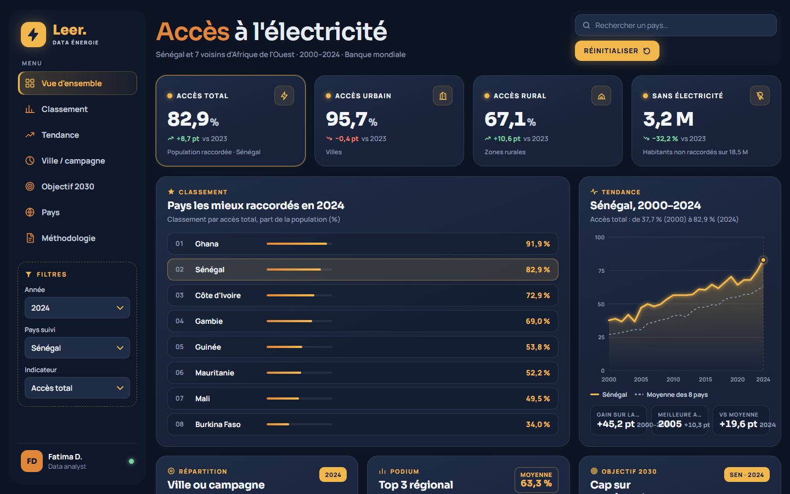

# Accès à l'électricité en Afrique de l'Ouest (2000-2024)

Analyse de l'accès à l'électricité au Sénégal et dans 7 pays voisins à partir des données de la Banque mondiale : un pipeline de données en Python et SQL (DuckDB), et un tableau de bord interactif pour lire les résultats.

**Tableau de bord en ligne : [analec-dashboard.vercel.app](https://analec-dashboard.vercel.app/)**

[](https://analec-dashboard.vercel.app/)

## La question

Le Sénégal a beaucoup progressé sur l'électrification, mais à quel rythme, pour qui, et où se situe-t-il par rapport à ses voisins ? J'ai voulu répondre à quatre questions simples :

1. Comment l'accès à l'électricité a-t-il évolué entre 2000 et 2024 ?
2. L'écart entre villes et campagnes se réduit-il ?
3. Où se situe le Sénégal face à la Côte d'Ivoire, au Ghana, au Mali, à la Guinée, à la Mauritanie, à la Gambie et au Burkina Faso ?
4. Au rythme actuel, l'objectif d'accès universel en 2030 (ODD 7.1) est-il atteignable ?

## Ce que montrent les données

- **Au Sénégal, la part de la population raccordée passe de 37,7 % en 2000 à 82,9 % en 2024**, soit +45 points en 25 ans.
- **La campagne rattrape la ville.** L'accès rural passe de 12,8 % à 67,1 % (multiplié par 5), alors que l'accès urbain plafonne autour de 96 %. L'écart ville-campagne se réduit de 61,8 à 28,6 points.
- **Environ 3,2 millions de Sénégalais restent sans électricité en 2024**, sur 18,5 millions d'habitants.
- **Le Sénégal est 2e sur 8 en 2024** (82,9 %), derrière le Ghana (91,9 %). Le Burkina Faso ferme la marche (34,0 %).
- **Prudence sur les dernières années** : le bond de 2022 à 2024 (+15 points) coïncide avec une nouvelle enquête ménages. Une partie de la hausse vient sans doute du changement de mesure, pas seulement de nouveaux raccordements (voir « Limites »).

## Démarche

```
API Banque mondiale  ->  JSON bruts  ->  DuckDB (raw -> staging -> marts)  ->  Parquet  ->  tableau de bord
```

| Étape | Script | Ce qu'il fait |
|---|---|---|
| Extraction | `src/extract.py` | Interroge l'API de la Banque mondiale pour 4 indicateurs et 8 pays (2000-2024). Nouvelles tentatives en cas d'échec, et reprise sans retélécharger ce qui existe déjà. |
| Chargement | `src/load.py` | Charge chaque fichier JSON dans une table du schéma `raw` de DuckDB, avec la date de chargement. Relançable sans doublons. |
| Transformation | `src/transform.py` + `sql/` | Exécute les requêtes SQL dans l'ordre : nettoyage et mise au format long (`staging`), puis tables finales (`marts`). |
| Export | `src/export.py` | Exporte les tables finales en Parquet (`data/export/`), lisibles par Power BI ou pandas. |

Les indicateurs utilisés :

| Code Banque mondiale | Indicateur |
|---|---|
| `EG.ELC.ACCS.ZS` | Accès à l'électricité (% de la population) |
| `EG.ELC.ACCS.UR.ZS` | Accès en zone urbaine (%) |
| `EG.ELC.ACCS.RU.ZS` | Accès en zone rurale (%) |
| `SP.POP.TOTL` | Population totale |

## Modèle de données

Un modèle en étoile simple, dans le schéma `marts` :

- **`dim_pays`** : une ligne par pays (code ISO3, nom en français, indicateur `est_senegal`).
- **`fct_electricite`** : une ligne par pays et par année, avec les indicateurs et trois calculs métier :
  - `ecart_urbain_rural` = accès urbain - accès rural (en points) ;
  - `pop_sans_electricite` = population x (100 - accès total) / 100 ;
  - `rang_acces` = rang du pays chaque année selon l'accès total (fonction de fenêtre `RANK()`).

## Le tableau de bord

Le dossier `dashboard/` contient une page web autonome (HTML, CSS et JavaScript, sans bibliothèque). Elle lit `donnees.js`, une copie de la table `marts.fct_electricite` jointe à `dim_pays` (une ligne par pays et par année), ce qui permet de l'ouvrir sans serveur :

- 4 indicateurs clés avec l'évolution sur un an ;
- classement des 8 pays et podium ;
- courbe 2000-2024 du pays choisi, comparée à la moyenne régionale ;
- répartition ville / campagne ;
- trajectoire vers l'objectif 2030 : rythme des 5 dernières années comparé au rythme nécessaire ;
- matrice complète des pays, triable ;
- filtres par année, pays et indicateur, recherche d'un pays ;
- affichage clair ou sombre selon le réglage de l'ordinateur.

Version en ligne : https://analec-dashboard.vercel.app/ (ou, en local, double-cliquer sur `dashboard/index.html`).

## Limites

- **Estimations modélisées.** La Banque mondiale combine des enquêtes ménages (DHS, MICS, enquêtes nationales) et un modèle pour les années sans enquête. Un saut brutal signale souvent une nouvelle enquête plutôt qu'un vrai changement.
- **Données manquantes.** L'accès rural n'est pas publié certaines années (Mauritanie depuis 2013, Burkina Faso 2015-2021, Guinée 2000-2005, Mali 2000, 2001, 2010, 2012 et 2017, Gambie 2018-2019). Ces valeurs restent vides : je n'ai rien interpolé.
- **Accès ne veut pas dire service.** Être raccordé ne dit rien des coupures, de la qualité du courant ni de son coût. Pour aller plus loin : durée des coupures (SAIDI), consommation par habitant, mix électrique, tarifs.

## Lancer le projet

Prérequis : Python 3.11 ou plus récent.

```bash
python -m venv .venv
.venv\Scripts\activate          # Windows (sur macOS / Linux : source .venv/bin/activate)
pip install -r requirements.txt

python src/extract.py           # télécharge les données brutes
python src/load.py              # charge DuckDB (schéma raw)
python src/transform.py         # staging et marts
python src/export.py            # exporte en Parquet
```

La base `data/warehouse/electricite.duckdb` n'est pas versionnée : elle se recrée en relançant les scripts. Les données brutes et les exports Parquet sont fournis dans `data/`.

## Organisation du dépôt

```
data/
  raw/worldbank/      réponses brutes de l'API (JSON)
  export/             tables finales (Parquet)
sql/
  01_staging.sql      nettoyage, format long
  02_marts.sql        modèle en étoile et calculs métier
src/                  scripts du pipeline (extraction, chargement, transformation, export)
dashboard/            tableau de bord (index.html, style.css, app.js, donnees.js)
```

## Outils

Python (requests, pandas), SQL, DuckDB, Parquet, HTML / CSS / JavaScript.

## Source

Banque mondiale, World Development Indicators : https://data.worldbank.org

## Auteure

**Fatoumata Dieye**, data analyst à Dakar
fatima.dieye03@gmail.com
